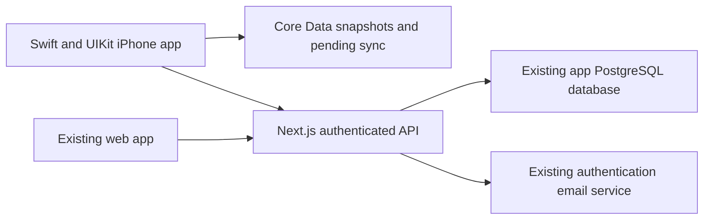

# Together Strong mobile app plan

Planning date: 27 October 2026. Status: first milestone implemented locally and verified on simulator; physical-device validation pending.

## Agreed direction

Build a private iPhone app for the two current users using Swift and UIKit in an Xcode project. Keep the existing web app available and use the same authenticated accounts and workout history.

The first release should make the current routine easier to follow on a phone: open the app, resume the right session, record a set, rest, and finish without losing entries. Broader household signup, subscriptions, social features, Apple Watch, HealthKit, AI coaching, and custom workout programming are outside this release.

Use UIKit for all application screens, navigation and controls, with programmatic Auto Layout. Keep the Next.js API and PostgreSQL database on the server. Implement the workout rules and exercise geometry in Swift, preserving compatibility through shared JSON fixtures and contract tests. The iOS app will not execute the existing TypeScript code.

Choose the supported Xcode/Swift toolchain and minimum iOS deployment target after checking both users' iPhones. Use Swift concurrency supported by that toolchain. Android is outside this plan and would require a separate client implementation.

## Implementation progress

The first Swift/UIKit milestone is implemented in `ios/TogetherStrong.xcodeproj`. It includes native sign-in, Keychain session restoration, workout loading, revision-protected preference sync, Core Data recovery and sign-out. The backend supports signed native bearer sessions while preserving browser protections.

On 27 October 2026, 13 native tests and two UIKit UI tests passed on the iPhone 17 Pro simulator with iOS 26.5. The live tests used synthetic accounts in the dedicated app database and verified an unsynced preference surviving process termination before sync. All 50 web regression tests passed. Debug simulator and unsigned Release hardware builds compiled.

Phase 1's physical-iPhone exit condition remains pending. API deployment, device signing and TestFlight distribution have not been performed. Full workout logging, exercise guides, timer, history and progress screens remain in the following phases. See `ios/README.md` for setup, test commands and current limitations.

## What the repository already provides

This assessment comes from source inspection. It does not establish current deployment health, database contents, or real email delivery.

| Existing capability | Source | iOS treatment |
| --- | --- | --- |
| Two profiles with different exercise emphasis, seven exercises, beginner ramp-up, validation, session dates and state | `lib/workout.ts` | Implement equivalent Swift models and rules; check both implementations against common fixtures. |
| Exercise-specific pose calculations | `lib/exercise-motion.ts` | Port the geometry to Swift and draw it with Core Graphics/Core Animation. |
| Sign-in, invited email setup, password reset and verified account ownership | `lib/auth.ts`, `app/api/account/`, `app/api/auth/` | Keep the account model; prove native HTTP authentication and session lifecycle. |
| Authenticated workout reads/writes with revision conflicts | `app/api/workouts/route.ts` | Keep the JSON contract and revision checks; add a deliberate native request policy. |
| Workout, history, progress, profile controls, guides and rest timer | `app/tracker.tsx`, `app/workout-today.tsx`, `app/exercise-visual.tsx` | Implement UIKit view controllers, reusable cells and sheets. |
| Browser-local preview and cloud storage adapters | `lib/storage.ts` | Implement account-scoped Core Data persistence and a durable sync queue. |
| Workflow, accessibility, conflict and exercise-motion regression scenarios | `tests/`, `scripts/verify-integration.mjs` | Use these as behavioral specifications for Swift unit tests and XCTest UI tests. |

The current HTML/CSS components, React state and browser APIs remain in the web app. The reusable assets are the backend, API contract, exercise content and expected behavior. Database credentials, mail credentials, server routes and auth secrets must stay in the backend.

## First-release experience

Use four tabs: Workout, History, Progress and Profile. Exercise guides, the rest timer and session details open as focused screens or sheets.

| Area            | Required behavior                                                                                                                                                                                                         |
| --------------- | ------------------------------------------------------------------------------------------------------------------------------------------------------------------------------------------------------------------------- |
| Account entry   | Sign in to an existing account. Offer private email setup and password reset with clear expiry and retry states. Derive the allowed profile from the authenticated account.                                               |
| Workout home    | Show the current training week, the user's routine and any resumable session. Make Start and Resume clear. Preserve all three warm-up paths.                                                                              |
| Active workout  | Show exercise guidance, target reps, set rows, reps and kg entry, completion and undo. Keep the next action reachable above the keyboard. Show previous recorded values as reference, without silently prefilling a load. |
| Rest timer      | Start from the exercise's rest duration; support pause, resume, reset and adding time. Restore the correct remaining time after locking or reopening the phone. Offer a local completion alert when permission allows.    |
| Exercise guide  | Include start/middle/finish positions, play/pause, slow speed, scrub and reset, text cues and existing reference links. Respect reduced motion and pause animations when inactive.                                        |
| Save and finish | Autosave edits locally. Keep Save progress, Save & pause and Finish distinct. Explain whether changes are on this phone, syncing, or synced. An offline finish remains visibly pending cloud sync.                        |
| History         | List completed sessions and recoverable drafts. Resume older sessions with their original date. Support the existing reopen/undo-completion behavior.                                                                     |
| Progress        | Show completed workouts, completed sets, this week's sessions and exercise trends using the existing metric definitions. Label any totals that include pending local changes.                                             |
| Profile         | Show the signed-in profile, beginner set preference, reminder preferences, account recovery, sync status and sign-out. Switching to the other person requires that person's authentication.                               |

Design for one-handed use, large text, VoiceOver, adequate contrast, safe areas, numeric keyboards and explicit input errors. Preserve the project's visual identity while using familiar iPhone navigation and controls.

## Rules that must carry over

- Keep each person's records private. The existing two-person positioning does not imply permission to view a partner's workout history.
- Keep total-held kg, per-side rep conventions and bodyweight handling consistent with the web app.
- Start the beginner programme clock only after a real completed set. Empty drafts never count toward completed workouts or consistency.
- Preserve the existing draft, active, paused, completed and recoverable-discard behavior. Repeated Start or Finish actions must not duplicate sessions.
- Count completed training on its completion date and preserve older drafts' original dates. Make calendar-day behavior explicit and consistent across the web and iPhone clients, including midnight and timezone changes.
- Preserve validation bounds, recovery after failed saves, and revision checks. A retry must never silently replace newer cloud data.
- Carry over the existing exercise instructions and safety copy. This project is a software migration; new training or medical guidance is outside scope.

## Architecture and code organisation



Keep the native project beside the existing web application:

```text
app/                              existing Next.js application and API
lib/                              existing web/server rules and adapters
ios/TogetherStrong.xcodeproj      native iOS project
ios/TogetherStrong/App/           app/scene lifecycle and navigation
ios/TogetherStrong/Features/      account, workout, history, progress, profile
ios/TogetherStrong/Domain/        Swift models, validation, routines, pose geometry
ios/TogetherStrong/Services/      networking, authentication, sync, notifications
ios/TogetherStrong/Persistence/   Core Data model and local repository
ios/TogetherStrong/Resources/     assets and bundled exercise content
ios/TogetherStrongTests/          Swift unit and API contract tests
ios/TogetherStrongUITests/        XCTest UI automation
contracts/fixtures/               synthetic JSON inputs and expected results
docs/MOBILE_APP_PLAN.md           this plan
```

Use small view controllers with view models where they simplify state, plus a navigation coordinator for account entry and the main tabs. Keep domain calculations separate from UIKit. Prefer Swift structs and enums for models and explicit states, `Codable` for transport, and `async`/`await` for network operations. UI state belongs on the main actor. Use Core Data's context confinement for persistence and an explicit serial sync loop; actor isolation alone does not guarantee request ordering.

Recommended native building blocks:

| Responsibility | Technology and approach |
| --- | --- |
| Screens and navigation | UIKit, `UITabBarController`, `UINavigationController`, collection/table views and native sheets. Use Auto Layout and Dynamic Type. See [UIKit](https://developer.apple.com/documentation/uikit). |
| Workout inputs | Reusable set-entry cells with accessible labels, decimal/numeric keyboards and a keyboard accessory for advancing or dismissing. Preserve focus during row updates and support locale-specific decimal input while keeping API kg values canonical. |
| HTTP and JSON | `URLSession`, `URLRequest` and `Codable`, with typed handling for authentication failure, conflicts, validation and transport errors. |
| Session secrets | Keychain Services with deliberate accessibility and backup choices. Do not store passwords or session tokens in `UserDefaults` or the workout database. See [Keychain Services](https://developer.apple.com/documentation/security/keychain-services). |
| Durable workout storage | Core Data with an SQLite-backed store. Save the workout snapshot and pending sync state together. Define file protection, backup policy and store migration behavior. See [Core Data](https://developer.apple.com/documentation/coredata). |
| Exercise illustrations | A custom `UIView` using `UIBezierPath`, `CAShapeLayer` and Core Graphics. Use one normalized pose model for static positions, scrubbing and animation. |
| Timer and reminders | Persist the rest deadline; use `UNUserNotificationCenter` for optional local alerts and workout reminders. Recompute remaining time on scene activation. Alerts depend on user permission and OS settings. See [Apple's local notification guidance](https://developer.apple.com/documentation/usernotifications/scheduling-a-notification-locally-from-your-app). |
| Tests and diagnostics | Swift Testing for domain/contract tests, XCTest with XCUIAutomation for UI flows, Instruments for measured performance problems, and privacy-conscious `Logger` diagnostics. See [Apple's testing guidance](https://developer.apple.com/documentation/xcode/testing). |

Keep the existing API data format initially: reps and kg remain strings in transport, session state fields remain compatible with legacy records, and optional dates/fields round-trip without loss. Separate date-only workout days from timestamp values. Freeze the existing JSON field names, date formats and validation semantics in synthetic fixtures consumed by both TypeScript and Swift tests.

Keep local persistence and transport models separate so a Core Data migration does not silently change the server payload. Do not add a separate push server for this release. Reminders are scheduled on the phone, and rest timing does not require remote push or continuous background execution.

## Backend and authentication work

Prove native authentication before building out all screens. Use a small `URLSession` client against documented HTTP endpoints, with the existing Better Auth backend as the account authority.

1. Evaluate and enable Better Auth's bearer-token plugin for this native client. Obtain the session credential through email/password sign-in, store it in Keychain, and attach it only to the approved HTTPS API origin. Verify the exact sign-in response, token signature policy, expiry, rotation and `getSession` behavior against the installed backend version. This is a server session credential, not an invented JWT or a secret embedded in the app. See [Better Auth's bearer-token documentation](https://better-auth.com/docs/plugins/bearer).
2. Prove sign-in, account lookup, workout load/write, app relaunch, sign-out and server-side session revocation from a real iPhone development build. Keep cookie-based web sign-in working. Do not assume authentication response cookies in a browser automatically populate a native session.
3. Adapt the explicit origin checks in workout writes and password setup. They currently require the browser origin to match the request host. Permit the native path only after verifying a valid bearer session and profile ownership; retain origin/CSRF checks for browser cookie requests. Define handling of mixed cookie/bearer credentials and reject invalid bearer credentials instead of falling back to a cookie. A claimed platform or origin header grants no access.
4. Use environment-specific HTTPS API configuration and normal iOS transport security. Allowlist credential-bearing requests and redirects so tokens cannot leave that origin. Ship no database, mail or signing secrets in the app.
5. For the first release, retain the existing HTTPS browser flow for private account setup and password reset. Open the approved pages from the app, preserve their explicit confirmation, expiry and single-use behavior, then require normal app sign-in after browser completion. Verify this from the iPhone mail app with the app installed, absent, closed and already open. A future verified Universal Link can improve return navigation without carrying session credentials in URLs; it is not required for the first release.
6. Keep generic setup/reset responses, invitation restrictions and rate limits. Test that reset revokes the native session as well as web sessions. Never log passwords, session credentials, private authentication URLs or workout contents. Clear native session state on sign-out and invalidate the session on the server; define an explicit local-only sign-out state when the network is unavailable.

Keep the existing workout endpoint and version-1 data shape initially. It currently stores one JSON document per user, with a revision, a 300,000-character request limit and a 1,000-session validation limit. Include compatibility tests at those limits. A per-session API and historical pagination can follow if actual usage justifies them.

## Offline saves and conflict handling

Offline support is part of workout reliability, not an anonymous fallback mode.

1. Require online sign-in and an initial successful load before enabling an account's offline workout data.
2. Commit each accepted edit and its pending sync marker in one local database transaction. Show a saved-on-this-phone state only after that commit succeeds.
3. Maintain one sync worker per account. Coalesce local edits into the latest snapshot and send writes serially with the last confirmed server revision.
4. Persist the last confirmed cloud snapshot, its revision, the current local snapshot and enough pending request state to recover after termination. If a response is lost after the server saved successfully, refetch and compare before retrying; do not blindly resend a stale revision.
5. Retry on reconnection and app foregrounding. Never promise continuous background execution. If a session expires, keep pending work protected and require reauthentication to the same account before upload.
6. On HTTP 409, stop automatic writes and preserve the base, local and current cloud copies. Provide a clear conflict screen. For this small release, explicitly select a complete version after showing the differences; keep a recoverable backup of the other version. Any selected upload uses the latest server revision and can conflict again. Automatic field merging is deferred.
7. Scope all caches and queues to the authenticated account. Sign-out must never silently discard pending work or expose it to the next account. Offer sync-and-sign-out or an explicit, clearly explained local-data removal choice. Cancel account-specific reminders and clear session secrets on sign-out.

Document local retention and device-backup behavior. Cached workouts should disappear from the app after an explicit local-data removal. Existing offline access does not prove that a server session remains valid; check authorization again before any sync.

## Delivery phases

Estimate 5–7 focused development weeks for one developer to reach a reliable private beta. This includes implementing the UIKit screens and porting/testing the workout rules in Swift. Revise the estimate after the first phase. Apple account setup, review waiting time and longer-term distribution decisions sit outside that estimate.

| Phase | Work | Exit condition |
| --- | --- | --- |
| 1. Native technical proof, 3–4 days | Verify backend/environment, Xcode/Swift and both phones; set the deployment target; create the UIKit project; prove native bearer auth, Keychain persistence and protected read/write against isolated test data. | A real iPhone signs in, restores its session after relaunch and round-trips a synthetic workout; the web client still works. |
| 2. Swift rules and UIKit workout, 5–7 days | Write Codable models and domain rules, establish common JSON fixtures, build account entry, tabs, warm-up and workout logging. | Swift and TypeScript agree on fixture results; each user can complete the routine with correct inputs, validation, dates and session state. |
| 3. Durable saves and timer, 5–7 days | Implement Core Data, serial sync, account boundaries, conflict UI, session recovery and deadline-based timer/local alerts. | Force-close, network loss and simultaneous web edits preserve recoverable data. |
| 4. Guides, history and progress, 5–7 days | Port geometry and native drawing, animation controls, history/draft recovery, UIKit progress views, profile preferences and reminders. | Current web behavior is available on iPhone, with usable VoiceOver and Dynamic Type. |
| 5. Private beta, 4–5 days | Run device regression checks, prepare icon and launch assets, configure signing and Release archives, complete beta metadata and install through TestFlight. | Both users complete real workouts and verify their own history on the web and phone. |

Keep each phase usable and reviewable. The first implementation ticket is the native authentication/read-write proof, because it resolves the largest integration uncertainty early.

## Verification and release gates

Use synthetic identities and an isolated test database for destructive and account-recovery checks. Confirm the environment separation before running integration scripts. Preserve real workout records.

- Rule parity: run the same synthetic fixtures through TypeScript and Swift for routine differences, beginner ramp-up, set validation, date handling, empty drafts, idempotent completion and pose geometry. Add Codable round-trip checks for current and legacy payloads.
- Native flows: XCTest UI coverage for keyboard entry, warm-up choices, pause/resume, guide controls, history recovery, completion undo and progress calculations. Use Swift Testing for domain and service tests; mock HTTP responses with URLProtocol where appropriate.
- Resilience: offline launch after initial sync, airplane-mode logging, process termination immediately after a Core Data save, local-store migration, reconnect, lost server response, 409 conflict, expired session and failed local storage.
- Account boundaries: unauthenticated and cross-profile API denial, setup/reset replay and expiry, sign-out with pending edits and no cache leakage between accounts. Retain browser-origin regression checks.
- Timer: lock screen, background/foreground, restart, denied notification permission, pause, reset and added time. Verify the countdown from its stored deadline even when no alert appears.
- Devices: both actual iPhones, the smaller supported layout, dark/light appearance, VoiceOver, reduced motion and large text.
- Build and web regression: compile and test the native targets with xcodebuild, exercise a signed Release build, and run existing web typecheck, lint, build and relevant browser/integration checks after API or fixture changes. Existing Playwright tests do not establish UIKit behavior.
- Release: install and update the signed beta without losing local drafts; confirm no secrets in the bundle; verify both accounts sync with their existing web histories. Record device/build/backend versions and unresolved issues.

## Private iPhone distribution

Start with email-invited TestFlight testing. Each build is usable for up to 90 days, and external testing can require Apple review. Treat this as a beta channel with a rebuild cadence, not a permanent installation. See [Apple's TestFlight overview](https://developer.apple.com/help/app-store-connect/test-a-beta-version/testflight-overview/).

For continued use by only these two people, evaluate ad hoc distribution to their registered iPhones. This requires Apple signing, device registration and ongoing provisioning maintenance. Confirm the renewal/update process before choosing it. See [Apple's ad hoc provisioning guidance](https://developer.apple.com/help/account/provisioning-profiles/create-an-ad-hoc-provisioning-profile).

An unlisted App Store release is a later option only if Apple accepts the finished app for that distribution method. Anyone with its link can download it, so the two-account restriction must remain enforced by the backend. See [Apple's unlisted distribution guidance](https://developer.apple.com/support/unlisted-app-distribution/).

Use Xcode archives and App Store Connect/TestFlight for distribution, with xcodebuild for repeatable local or CI builds. Before release work, establish the Apple Developer account owner, both iPhone models/iOS versions, bundle identifier, signing access and Development/Release configuration. Confirm any Apple membership, CI or infrastructure costs when choosing services. This plan does not assume those accounts or purchases already exist.

## Success criteria

Both users can install the iPhone beta, sign into their own existing account, follow the current routine, record and recover a workout through a connection failure or app restart, and see the same completed history on the web after sync. Neither can read or overwrite the other's records. Conflict recovery, account recovery and the private update/install process have been tested on real devices.

Android would need a separate native client plan. Additional users and larger product changes require a separate scope decision after the iPhone beta.
